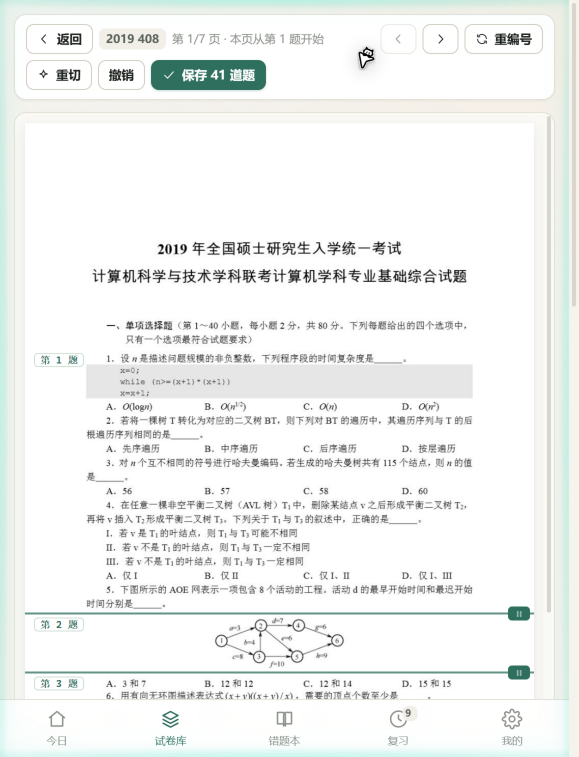
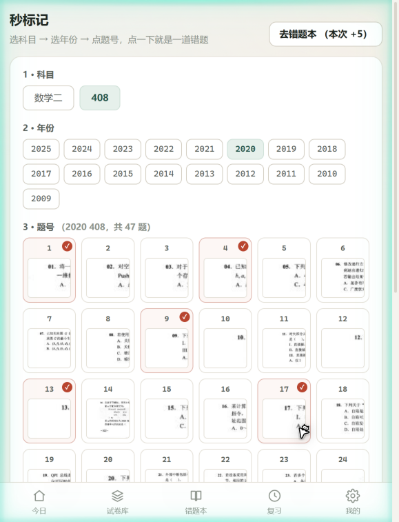
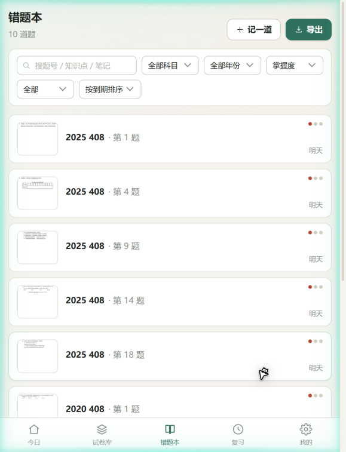
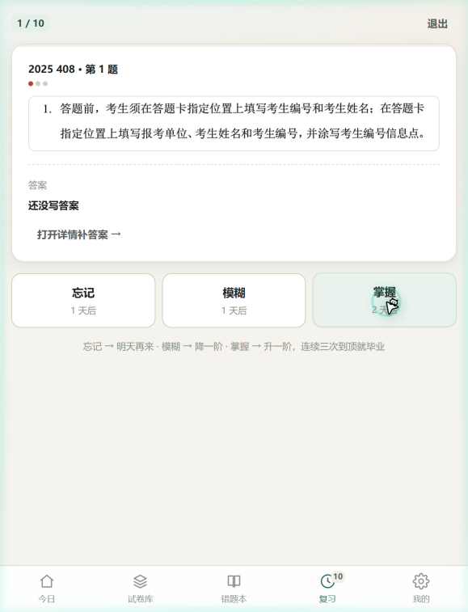
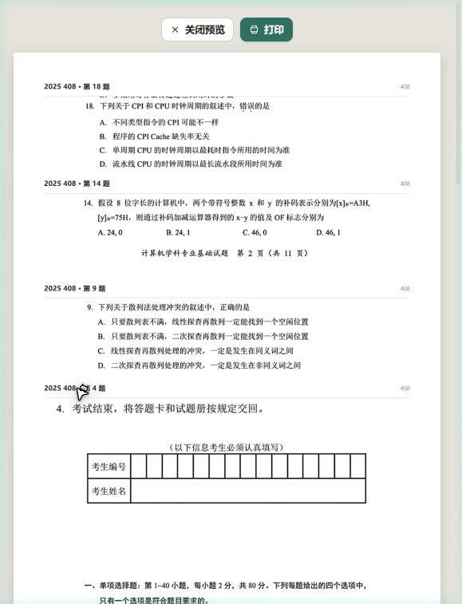
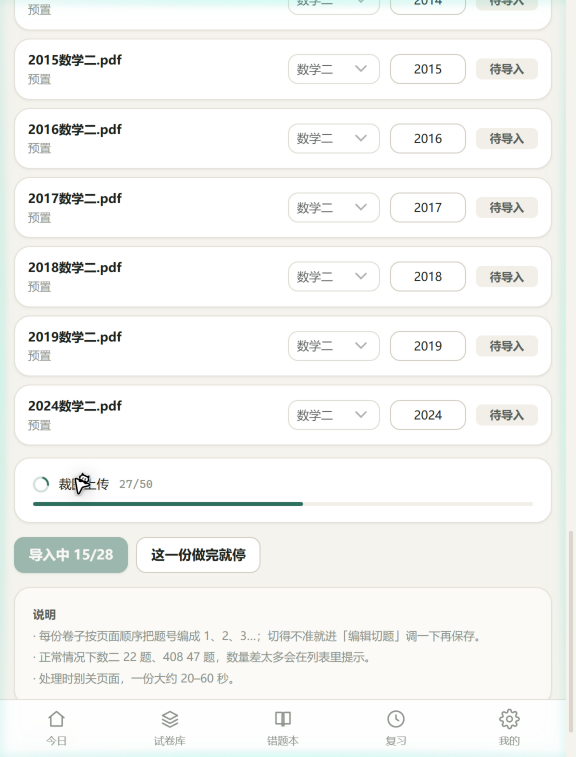
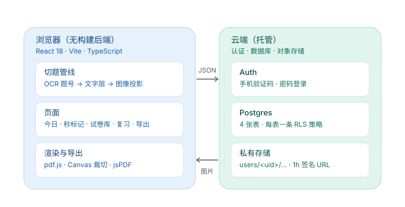

# 错题集

> 把扫描版考研真题，变成一份「点一下题号就能标记」的错题本。

上传真题 PDF → 自动切成单题图片 → 错题只记「年份 + 题号」→ 按间隔重复复习 → 导出成带作答留白的可打印练习卷。

数二 / 408 两科，28 套真题实测可用。React 18 + TypeScript + Vite，无自建后端。

---

## 为什么做这个

错题本的真正成本不在「复习」，在「录入」。抄题慢、拍照乱、贴标签想不起来用。

这个项目的取舍是把录入成本压到接近零：

- **建库一次，用一辈子**：每套真题只需要切一次题，之后所有题目都在库里
- **标记只要两下**：选年份 → 点题号，不需要打字、不需要传图
- **题目以图片存**：不做公式 OCR，不改排版，扫描件长什么样就存什么样，不用担心公式变乱码

代价是每套卷子建库时要花 3–5 分钟切题（有自动切题打底，多数卷子只需要确认一遍）。

---

## 功能

| 模块 | 说明 |
|---|---|
| 批量导入 | 一次拖入多份真题 PDF，自动识别科目年份、逐份切题入库，支持断点续跑 |
| 切题编辑器 | 自动切完后可拖线微调：双击题目内部拆分、双击分割线合并、`M` 并入上一题、`Ctrl+Z` 撤销 |
| 秒标记 | 选科目 → 年份 → 点题号，一下一道错题；也支持在试卷详情里框选批量标记 |
| 错题本 | 按科目 / 年份 / 知识点 / 掌握度 / 到期状态筛选，支持关键词搜题号与笔记 |
| 间隔复习 | 忘记 / 模糊 / 掌握三档打分，自动排 1·2·4·7·15·30 天的复习计划 |
| 导出 | 筛选后排版成 A4，按题型自动留作答区（选择 0 / 填空 22mm / 解答 82mm），走浏览器打印或直接下载 PDF |
| 统计 | 按年份、知识点、错误原因分布，看哪块最薄 |
| 账号 | 手机验证码 / 密码登录，电脑手机同一个账号，数据在云端 |

---

## 界面

**切题编辑器**——绿色是自动切出来的分割线，拖一下就能改。第 1 题准准地落在第一道真题上，卷头已被排除：



**秒标记**——左边选科目和年份，右边点题号，点一下就进错题本：



| 错题本 | 复习 |
|---|---|
|  |  |
| 到期 / 掌握度 / 知识点多维筛选 | 三档打分，自动排下次复习时间 |

**导出**——按题型自动留作答区，预览就是最终的 A4 版式：



**批量导入**——一次拖入整批 PDF，自动识别科目年份：



---

## 在线演示（GitHub Pages）

仓库带一个 **demo 构建**（`npm run build:demo`），`.github/workflows/pages.yml` 会在推送到 `main` 后自动发布到 GitHub Pages。

demo 模式的关键点：**不连云端**，`cloud` 被换成一个内存实现，数据存在浏览器 `localStorage` 里。刷新还在，换个浏览器打开就没了。

> **demo 里没有真题。** 题图是 canvas 画的占位图，只有 2 套卷、22 道题的骨架，用来看交互。
> 你要看真实效果，得把自己的真题导进去 —— 见下一节。

为什么不在 demo 里塞真题？因为真题版权不属于这个项目，而且云端数据本来也只在你自己账号里。

---

## 用起来：导入自己的真题

一套卷子只需要切一次，之后所有题目都在库里，可以一直用。

**① 准备 PDF**
自己买的真题，扫描版或数字版都行。放在任意目录，不用改名（文件名里的年份和「408 / 数二」会被自动识别）。

**② 建库**
`试卷库` → `批量导入` → 把 PDF 拖进去（可以一次选十几份）→ 核对识别出的科目和年份（不对就直接改）→ `开始导入`。

每份 30–60 秒，处理时别关页面。全部跑完会显示每套切出多少题，和标准题量差太多会标「建议检查」。

**③ 核对切题**
进 `试卷库` → 点某套卷的 `看题目`，缩略图对上就行。有偏差的进 `编辑切题`：

- 拖动绿色分割线调整边界
- 双击题目内部 = 在这里拆成两题
- 双击分割线 = 删掉它、上下合并
- 选中某题按 `M` = 并入上一题（解答题跨页时用）
- `[` `]` 翻页，`Ctrl+Z` 撤销

改完点 `保存`。这一步值得认真做，切得准不准直接决定后面标记顺不顺手。

**④ 开始用**
做卷子时错了题，打开 `秒标记` → 选科目 → 选年份 → 点题号，一下就是一道。之后每天打开 `复习`，按「忘记 / 模糊 / 掌握」打分就行。

---

## 切题是怎么做的

这是整个项目技术含量最高的部分，也是最难做对的部分。**没有用版面分析模型**，纯几何 + OCR，三级降级：

```
① OCR 找题号  →  ② PDF 文字层题号  →  ③ 图像行投影
   命中就用         有文字层才用          最后兜底
```

### ① OCR 找题号（主力方案）

关键取舍：**不 OCR 整页，只 OCR 左边距 34% 的窄带**，并把 tesseract 的字符白名单锁成 `0123456789.．、()（）`。

- 题号永远在左边，窄带面积只有整页的 1/3，速度快 3 倍
- 白名单里没有汉字，中文噪声直接输出不出来
- 只取每行 `bbox.y0` 当切点，不关心识别出了什么字
- 题号两套格式都要兼容：408 是 `01.`，数二是 `（1）`

识别结果还要过两道校验才采信：题号必须是**从 1 开始递增、跳号不超过 3**的序列；总数必须落在**标准题量的 75%–140%** 之间。不满足就降级——宁可退回几何法，也不要用错的切点。

### ② PDF 文字层题号

数字排版的 PDF 自带文字层，可以用 `getTextContent()` 拿到每个文本块的坐标。理论上这是最准的，但这批真题的文字层是**残缺的**：题号被拆成 `"0 1 ."` 三个独立 item、有的页整个没有题号、数字全半角混用。检测率只有 9/47，所以只作为第二选择。

### ③ 图像行投影

把页面转灰度、Otsu 自动二值化，然后**逐行统计墨迹像素数**——文字行数值高，空白行接近 0。连续的低数值行就是一条空白带，长度超过 `max(3.2mm, 中位行距 × 1.7)` 就在中间切一刀。

再加一条**左边界二次切分**：对每一段取所有文本行的起始 x，做 2-means 聚类；如果明显分成「正文」和「缩进」两簇，说明这段里粘了两个新题，在缩进行处再切一刀。这一条是选择题的救命稻草——关掉它，408 的题数会从 47 掉到 23，因为题干和四个选项会被当成一整块。

最后是死规则：第 1 页顶部 30% 内、高度不到页高 20% 的段，判定为卷头直接丢弃。不丢的话它会变成「第 1 题」，把整套题号顶偏一位。

### 实测效果

真实题量：408 = 47 题，数二 = 23 题。

| 卷 | 真实 | 图像投影 | OCR |
|---|---|---|---|
| 408 · 2025 | 47 | 61 | **46** |
| 408 · 2014 | 47 | 35 | **46** |
| 408 · 2009 | 47 | 42 | **47** |
| 408 · 2021 | 47 | 49 | **47** |
| 数二 · 2018 | 23 | 24 | 20 |
| 数二 · 2014 | 23 | 23 | 20 |

接入 OCR 后，408 的 17 套全部落在 44–50 之间，其中 7 套正好 47；数二 11 套落在 20–23。抽查单题边界（题干 + 代码块 + 四个选项）完整，不多不少。

---

## 架构



浏览器承担全部重活——PDF 渲染、切题、裁图、排版都在本地完成，服务端只存数据。这样没有服务端算力成本，也避免把真题 PDF 传来传去。

数据安全靠数据库自带的行级权限：四张表各一条 `FOR ALL ... USING (owner_id = auth.uid())` 策略，`questions` 的写入还要额外校验所属 `paper` 的归属，`mistakes` 校验所属 `question` 的归属。图片走私有存储桶，读的时候签发 1 小时有效的链接，没有公开地址。

---

## 技术栈

| 层 | 选型 | 说明 |
|---|---|---|
| 框架 | React 18 + TypeScript + Vite | 无 SSR，纯 SPA，hash 路由 |
| PDF | pdfjs-dist | 按页渲染到 Canvas，144dpi 切题 / 200dpi 裁图 |
| OCR | tesseract.js 5 | CDN 按需加载，不进 bundle，只识别数字 |
| 导出 | jsPDF + html2canvas | 排版走 DOM，PDF 里中文走位图渲染，避免字体缺失 |
| 后端 | WorkBuddy Cloud | 认证 + Postgres + 私有对象存储，SDK 直连 |
| 样式 | 手写 CSS 变量 | 无 UI 框架，深浅色跟随系统 |

---

## 本地运行

```bash
npm install
npm run dev         # http://localhost:5273
npm run build       # 类型检查 + 构建（连云端）
npm run build:demo  # 只构建演示版（不连云端，可离线跑）
npm run preview     # 预览构建产物
```

想看 demo 效果，跑 `npm run build:demo && npm run preview` 就行，不需要任何云服务配置。

需要一份自己的云服务，把 key 写进 `src/lib/cloudConfig.ts`：

```ts
export const PUBLIC_CONFIG = {
  publishableKey: 'wbpk_...',
}
```

`endpoint` 故意不传——数据面和应用同域，SDK 会自动走同源。把实例域名写死进产物，换域名后旧地址就会失效。

这个 key **设计上可公开**（只标识应用、不携带权限），真正的安全边界是服务端的 **Origin 精确匹配**：只有应用的发布域名能调通接口。所以：

> **把仓库部署到 GitHub Pages 只能打开登录页，登录一定失败。**
> 题目数据在云端，不在仓库里；而 `github.io` 不在允许的 Origin 里，请求会卡在 CORS 预检。

数据库需要 4 张表 `papers / questions / mistakes / reviews`，每张表带 `owner_id default auth.uid()` 与对应 RLS 策略，字段映射见 `src/lib/repo.ts`。

---

## 数据模型

```
papers      一套卷：科目、年份、页数、状态、原始 PDF 路径、切题草稿
  └─ questions   一道题：题号、题型、题干图片数组、答案图片数组、答案文本
       └─ mistakes   一道错题：知识点标签、错误原因标签、掌握度、复习阶段
            └─ reviews    一次复习记录：打分、前后阶段、间隔天数
```

图片不存二进制，存的是存储键（`papers/<id>/q/<题号>-<序号>-<随机>.jpg`），读的时候换成签名 URL。复习阶段用 `stage`（0–5）+ `master_streak` 两个字段表达，对应间隔 `[1,2,4,7,15,30]` 天，连续三次掌握且 stage ≥ 4 就毕业。

---

## 已知限制

- **切题是启发式的**，不理解版面语义。题间空白小于行距 1.7 倍会切不开，大块答题空白会被误判成题间空白，双栏排版会横切两栏。目前 408 的 17 套里仍有几套差 ±3 题，需要手动微调
- **必须联网**，没有离线模式，数据只存在云端
- **只适配数二 / 408 两种卷型**，题型分布和留白规则是写死的
- **切题建议在桌面端做**，手机屏幕小、拖线精度差；标记、复习、导出在手机上都很好用
- 扫描质量差的卷子（模糊、倾斜、脏点）OCR 会失效，只能靠图像投影

---

## 声明

代码以 MIT 协议开源。

仓库**不包含任何真题 PDF**（`.gitignore` 已排除 `public/seed/`）。示例用的是自己购买的真题资料，版权归原出版方，请勿随仓库分发。
